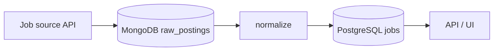

# ADR 001 — PostgreSQL for app data, MongoDB for raw and AI data

**Status:** Accepted
**Date:** 2026-10-13

## Context
The app stores two very different kinds of data:
- App data (users, jobs, applications, contacts) is relational, needs constraints and joins, and must be consistent.
- Raw job-source payloads and AI generation history have a different shape per source/prompt, are append-heavy, and are mainly kept for debugging and re-processing.

## Decision
PostgreSQL is the source of truth for app data. MongoDB stores raw payloads and AI history only. The app never joins on MongoDB data.

## Alternatives considered
- **PostgreSQL only (JSONB for raw data)** — simpler ops and a valid choice; rejected to keep large raw payloads and their TTL cleanup out of the main DB, and to practice MongoDB.
- **MongoDB only** — loses constraints and joins needed for applications and contacts.

## Consequences
- Good: clear split; raw data can be re-normalized when the normalizer improves.
- Bad: two databases to run, back up, and test.

## Interview angle
- **At scale:** raw payloads grow fastest, so they get a TTL index and, much later, sharding by source. Postgres scales reads with replicas; writes scale up first, then by partitioning `jobs` by date.
- **Failure modes:** there is no transaction across the two stores. Raw data is written first and normalizing is idempotent, so a failed normalize is re-run from Mongo. If Mongo is down, fetching pauses and retries; the app keeps serving from Postgres.
- **Likely follow-ups:** "Why not JSONB in Postgres?" "A write to one store succeeds and the other fails: what then?" "When does polyglot persistence cost more than it gives?"
