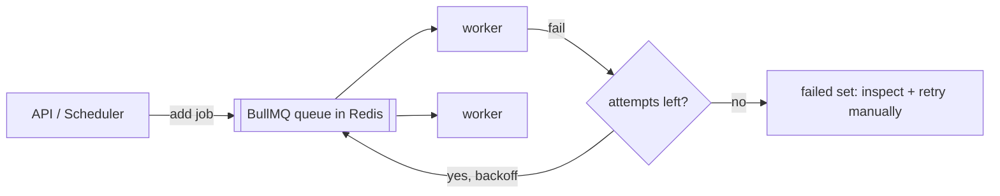

# ADR 002 — BullMQ on Redis for background jobs

**Status:** Accepted
**Date:** 2026-10-13

## Context
Fetching from many job sources, normalizing, scoring with AI, and generating drafts are slow and can fail. They must not block HTTP requests, and they need retries, scheduling, and rate limits.

## Decision
Use BullMQ (via `@nestjs/bullmq`) on Redis. Workers run in a separate NestJS app (`apps/worker`).

## Alternatives considered
- **RabbitMQ** — powerful, but another service to run; Redis is already needed for sessions and caching.
- **Kafka** — built for event streaming at scale; overkill here.
- **In-process cron** — no retries, no persistence, no horizontal scaling.

## Consequences
- Good: retries, backoff, delayed and repeatable jobs, concurrency control, one Redis for everything.
- Bad: Redis must be persistent (AOF) so queued jobs survive restarts.
