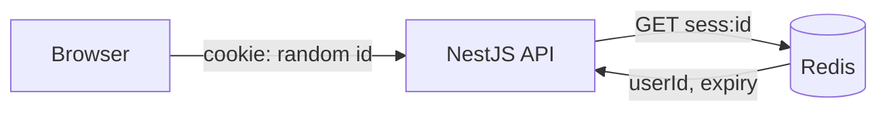

# ADR 003 — Server-side sessions with an httpOnly cookie (not JWT)

**Status:** Accepted
**Date:** 2026-10-13

## Context
Users sign in with email/password or SSO (Google, LinkedIn). The React app and API are served from the same site. We need safe login, instant logout, and "log out of all devices".

## Decision
Store sessions in Redis. The browser holds only a random 256-bit session id in a cookie:

`__Host-sid; HttpOnly; Secure; SameSite=Lax; Path=/`

The API does SSO itself (backend-for-frontend); the React app never sees any token.

## Alternatives considered
- **JWT in localStorage** — readable by any XSS; can't be revoked before expiry.
- **JWT in a cookie** — fixes XSS theft, but revocation still needs a server-side denylist, so it ends up being a session anyway.
- **Hosted auth (Auth0, Clerk)** — fast, but hides the exact skills this project should demonstrate, and may cost money.

## Consequences
- Good: instant revocation, nothing sensitive in the browser, simple mental model.
- Bad: every request reads Redis (fast; acceptable). CSRF must be handled (SameSite + CSRF token + Origin check).
