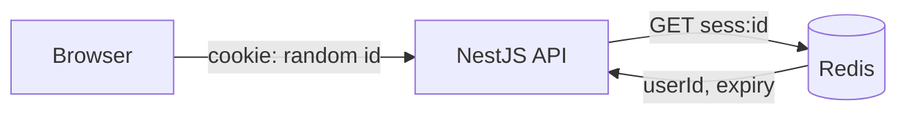

# ADR 003 — Server-side sessions with an httpOnly cookie (not JWT)

**Status:** Accepted
**Date:** 2026-10-13

## Context
Users sign in with email/password or SSO (Google, LinkedIn). The React app and API are served from the same site. We need safe login, instant logout, and "log out of all devices".

## Decision
Store sessions in Redis. The browser holds only a random 256-bit session id in a cookie:

`__Host-sid; HttpOnly; Secure; SameSite=Lax; Path=/`

The API does SSO itself (backend-for-frontend); the React app never sees any token.

## Alternatives considered
- **JWT in localStorage** — readable by any XSS; can't be revoked before expiry.
- **JWT in a cookie** — fixes XSS theft, but revocation still needs a server-side denylist, so it ends up being a session anyway.
- **Hosted auth (Auth0, Clerk)** — fast, but hides the exact skills this project should demonstrate, and may cost money.

## Consequences
- Good: instant revocation, nothing sensitive in the browser, simple mental model.
- Bad: every request reads Redis (fast; acceptable). CSRF must be handled (SameSite + CSRF token + Origin check).

## Interview angle
- **At scale:** every request reads and writes Redis. At high traffic, write `lastSeenAt` at most once a minute and shard by session id. With many services or regions, a short-lived JWT plus a refresh token avoids a central lookup on every hop.
- **Failure modes:** if Redis is down, nobody can be authenticated, so auth fails closed (401). Production needs a replicated or managed Redis.
- **Likely follow-ups:** "Sessions or JWT? Defend it." "How do you log out all devices?" "What does SameSite not cover?" More in the notebook: [auth and sessions](../learning/auth-sessions.md).
