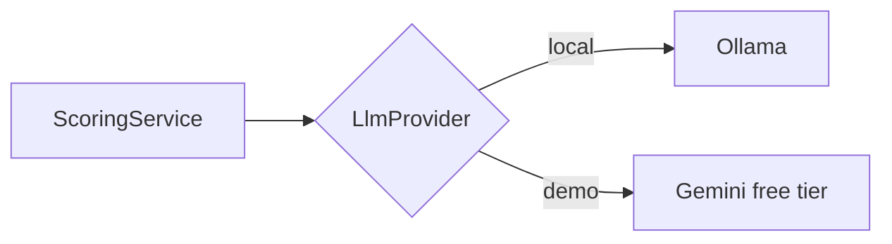

# ADR 004 — Free job sources and free AI only

**Status:** Accepted
**Date:** 2026-10-13

## Context
The app must be free to run. Big Israeli job boards (LinkedIn, AllJobs, Drushim) have no free public API, and scraping them breaks their terms.

## Decision
Job sources:
- Company career pages via ATS public job-board APIs (Greenhouse, Lever, Comeet, SmartRecruiters, Workable, Ashby), from a seed list of central-Israel companies.
- Hacker News "Who is hiring" via the free Algolia API.
- Manual paste of any job URL/text (covers LinkedIn and Israeli boards).

AI: an `LlmProvider` interface with Ollama (local) as default and Gemini free tier for the public demo. Embeddings run locally.

## Alternatives considered
- **Scraping LinkedIn / job boards** — violates terms; risk of account bans.
- **Paid LLM APIs** — better quality, but not free.

## Consequences
- Good: zero running cost; provider swap is a config change.
- Bad: coverage depends on the seed company list; local models are slower and weaker, so AI runs only on pre-filtered jobs.
