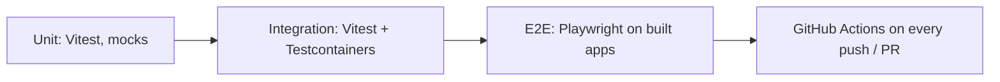

# ADR 005 — Toolchain: pnpm monorepo, ESM, TypeScript 6, Vitest, Playwright, raw drivers

**Status:** Accepted
**Date:** 2026-10-13

## Context
We need one repo for API, worker, web, and shared types, with fast tests at every level. NestJS 12 ships as ES modules only. TypeScript 7 (native compiler) is the latest release, but `typescript-eslint` supports `<6.1` and `ts-jest` supports `<7`.

## Decision
- **pnpm workspaces**: `apps/*` and `packages/*`; `packages/shared` is built to `dist` on install and watched in dev.
- **ES modules everywhere** (`"type": "module"`, `module: nodenext`, `.js` import suffixes), matching NestJS 12.
- **TypeScript 6.0** until the lint tooling supports 7.
- **Vitest** for unit and integration tests in all apps (the NestJS 12 starter default); **Testcontainers** for real databases; **Playwright** for E2E.
- **Raw drivers** (`pg`, `mongodb`, `ioredis`) behind repositories; no ORM until a feature needs one.
- **zod** validates env at startup.

## Alternatives considered
- **Jest** — needs extra setup for ESM; `ts-jest` does not support TS 7.
- **TypeScript 7** — faster, but breaks `typescript-eslint` today.
- **Prisma / TypeORM** — productive, but hide SQL and add generation steps; revisit when the schema grows.
- **Nx / Turborepo** — useful at scale; plain pnpm scripts are enough now.

## Consequences
- Good: one test runner, same module system everywhere, real-DB tests catch driver/config issues early.
- Bad: ESM requires `.js` suffixes in imports; integration tests need Docker running.
