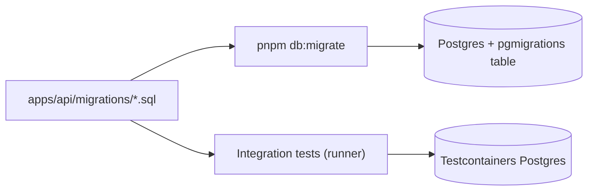

# ADR 006 — Database migrations with node-pg-migrate (plain SQL files)

**Status:** Accepted
**Date:** 2026-10-13

## Context
The first Postgres table (`users`) needs a repeatable way to change the schema. Our rules forbid manual schema changes, and we use the raw `pg` driver with no ORM ([ADR 005](005-toolchain.md)). The tool must run the same migrations locally, in integration tests (Testcontainers), and in CI.

## Decision
Use **node-pg-migrate** with migrations written as **plain SQL files** in `apps/api/migrations/` (`-- Up Migration` / `-- Down Migration` sections). Migrations run as an explicit step (`pnpm db:migrate`), not when the API starts. Integration tests call the library's `runner` against a throwaway database.

## Alternatives considered
- **Hand-written runner** — no dependency, but we would rebuild tracking, ordering, and locking.
- **dbmate** — good SQL-first tool, but a separate Go binary outside the Node toolchain.
- **Prisma / Drizzle / TypeORM migrations** — tied to an ORM or query builder we chose not to use.
- **Migrate on API startup** — convenient, but several API instances could race, and a bad migration would block startup.

## Consequences
- Good: SQL is reviewed as written; one small dependency built on `pg`; an advisory lock prevents concurrent runs; every migration has a tested down step.
- Bad / trade-offs: deploys and CI must run `pnpm db:migrate` before starting the API; the CLI loads `.env` through Node's `--env-file-if-exists` because its own dotenv support needs an extra package.

## Interview angle
- **At scale:** big tables need zero-downtime changes. Use **expand and contract**: add the new column, backfill in batches, switch the code, and drop the old column in a later release. Build indexes with `CREATE INDEX CONCURRENTLY` so writes aren't blocked.
- **Failure modes:** Postgres DDL runs in a transaction, so a failed migration rolls back cleanly. The real risk is ordering: code must work with both the old and new schema during a deploy. In production, teams usually roll forward with a new migration rather than run a down step.
- **Likely follow-ups:** "Rename a column with no downtime." "Migrate on startup or as a separate step?" "Are down migrations useful in production?" "How do you backfill 100M rows?"
