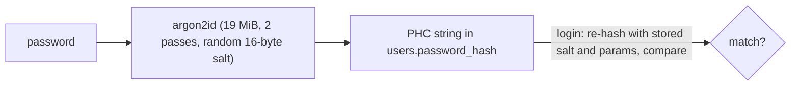

# ADR 007 — Password hashing with argon2id via `@node-rs/argon2`

**Status:** Accepted
**Date:** 2026-10-14

## Context
Email sign-up stores a password verifier in `users.password_hash`. If the database leaks, attackers will try billions of guesses per second on GPUs. The hash must be slow and memory-hungry, salted per user, and stored in a format that records its own parameters so we can raise the cost later. Spec 001 requires argon2id.

## Decision
Hash with argon2id at the OWASP minimum cost (m=19456 KiB, t=2, p=1) using `@node-rs/argon2`, which ships prebuilt Rust binaries. Store the PHC string, e.g. `$argon2id$v=19$m=19456,t=2,p=1$<salt>$<hash>`. Login for an unknown email or an SSO-only account runs a dummy verify, so timing doesn't reveal which emails exist.

## Alternatives considered
- **`argon2` (node-argon2)** — the most popular package, but it runs an install script (`node-gyp-build`), which pnpm blocks by default (`allowBuilds`). Allowing builds widens the supply-chain surface for no gain.
- **Node's built-in `crypto.argon2`** — no dependency, but it's new (added in Node 24.7) and returns raw bytes, so we would hand-write salt handling and PHC encoding and parsing (security-sensitive code).
- **bcrypt** — proven, but it's CPU-only (cheap on GPUs) and silently truncates passwords after 72 bytes.
- **scrypt (built in)** — memory-hard and stable, but it has no standard storage format in Node, and spec 001 names argon2id.

## Consequences
- Good: a modern memory-hard hash, no native build step, parameters stored per hash (we can raise the cost later and rehash on login), a 128-character password cap bounds the work per request.
- Bad / trade-offs: one more dependency with native binaries (prebuilt per platform). Each hash takes about 20–100 ms of CPU (depending on the machine) and 19 MiB of RAM, so login is a cheap DoS target until rate limits land (card 001-06).

## Interview angle
- **At scale:** hashing is the most expensive thing login does. At 1000 logins per second that is 20–100 CPU-seconds per second (that many cores busy), with 20–100 hashes running at once at 19 MiB each (up to about 2 GB of RAM). Move hashing to a worker pool or dedicated auth service, and rate-limit before hashing.
- **Failure modes:** a cost set too high slows down or exhausts memory on every login; set too low, leaked hashes crack faster. Unknown-email logins that skip hashing leak which emails exist through timing, which is why we run the dummy verify.
- **Likely follow-ups:** "Why not SHA-256 with a salt?" (fast hashes are made for speed, the opposite of what you want). "What's a pepper?" "How do you migrate from bcrypt?" (verify the old hash, rehash on successful login). More in the notebook: [password storage](../learning/password-storage.md).
