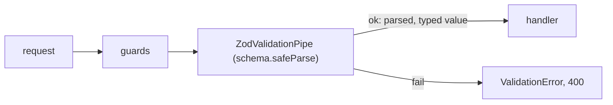

# ADR 008 — Request validation with zod schemas and a Nest pipe

**Status:** Accepted (schemas moved to `packages/shared` in [ADR 009](009-frontend-routing-auth-state-forms.md), so the web form uses them too)
**Date:** 2026-10-14

## Context
Request bodies arrive as untrusted JSON. TypeScript types disappear at runtime, so `body: CredentialsRequest` alone proves nothing. Every endpoint needs the same behavior: reject bad input with a readable 400, strip unknown keys, and hand the handler a typed value. We already use zod 4 for env validation (`apps/api/src/config/env.ts`).

## Decision
Each endpoint declares a zod schema, and `ZodValidationPipe` (`apps/api/src/http/zod-validation.pipe.ts`) parses the body with it. `@Body(new ZodValidationPipe(schema))`. On failure it throws `ValidationError` (a `DomainError`, 400), so the existing `DomainErrorFilter` formats it like every other error. Schemas are checked against the shared request types with `satisfies z.ZodType<T>`, so they can't drift apart.

## Alternatives considered
- **class-validator + class-transformer with `ValidationPipe`** — the NestJS default. It needs DTO classes with decorators, a second validation library next to zod, and `reflect-metadata` decorators on every field. Strong Swagger integration, which we don't need yet.
- **`nestjs-zod`** — does the same with extras (DTO classes, OpenAPI). Another dependency for a pipe that is 15 lines.
- **Validate by hand in each service** — inconsistent errors, and easy to forget.

## Consequences
- Good: one validation library for env and requests, readable error messages (`z.prettifyError`), schemas are plain values that the worker or web app could reuse later.
- Bad / trade-offs: no automatic OpenAPI docs from DTOs. Each handler must remember to add the pipe (a missing pipe means unvalidated input), though tests for each endpoint catch it.

## Interview angle
- **At scale:** validation is cheap compared with I/O. What matters is consistency across many services: share schemas or generate them from one contract (OpenAPI, protobuf) so clients and servers agree.
- **Failure modes:** a forgotten pipe accepts anything; an overly strict schema rejects real clients after a change (add fields as optional first, like expand and contract for APIs).
- **Likely follow-ups:** "Where does validation belong: controller, service, or database?" (all three, for different reasons: shape at the edge, rules in the service, constraints in the database). "Why not trust the TypeScript type?" More in the notebook: [password storage](../learning/password-storage.md).
