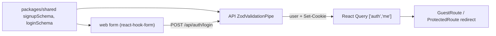

# ADR 009 — Frontend: React Router, auth state in React Query, react-hook-form with shared zod schemas

**Status:** Accepted
**Date:** 2026-10-14

## Context
The web app grows from one status page to several URLs, some only for signed-in users. The session lives in an HttpOnly cookie that JavaScript can't read (ADR 003), so the UI learns who is signed in only by asking `GET /api/auth/me`. Login and sign-up need forms whose rules match the API's (password 10-128 characters, valid email).

## Decision
- **Routing:** React Router (declarative mode: `<BrowserRouter>`, `<Routes>`, layout routes). `ProtectedRoute` and `GuestRoute` are layout routes that redirect based on auth state.
- **Auth state:** the React Query cache entry `['auth', 'me']` is the only source of truth. A 401 is stored as `null` (signed out), not as an error. Login and sign-up write the returned user into it; logout drops all other cached queries and writes `null`. Navigation follows from that state: no form calls `navigate()`.
- **Forms:** react-hook-form with `zodResolver`, using the same zod schemas the API validates with. The schemas moved from the API to `packages/shared`, so `shared` now ships runtime code (zod), not only types.

## Alternatives considered
- **TanStack Router** — fully typed routes and search params, but newer and less common in teams; more setup.
- **Wouter or a hand-written router** — tiny, but we'd rebuild layout routes and redirects.
- **React Context + useState for the user** — the classic pattern, but it re-implements loading, refetching, and invalidation that React Query already does.
- **Zustand/Redux for the user** — copies server data into a client store, where it goes stale.
- **Plain inputs with built-in HTML validation** — no dependencies, but the rules would be written twice and could drift from the API's.
- **Generate client types from OpenAPI** — strong for many endpoints and languages; heavy for a handful of endpoints in one TypeScript monorepo.

## Consequences
- Good: one set of validation rules and messages for browser and server; the UI's view of auth can't disagree with the server for long (re-checked when the tab regains focus after a minute); redirects are declared in one place.
- Bad / trade-offs: four new web dependencies (`react-router`, `react-hook-form`, `@hookform/resolvers`, `zod`), and zod (tens of KB) is now in the browser bundle. `packages/shared` must stay free of Node-only code, because the browser imports it. Every protected page load waits for `/auth/me` once (a short "Checking your session…").

## Interview angle
- **At scale:** with many pages and data calls, a global 401 handler (React Query's `QueryCache.onError`) should clear `['auth','me']` when any request finds the session gone. Route-level code splitting (`lazy`) keeps the first load small. Across many teams, schemas are shared through a contract package or OpenAPI/protobuf generation.
- **Failure modes:** if `/auth/me` fails with a 500 or the network is down, `ProtectedRoute` shows the error instead of pretending the user is signed out. Client checks are only for user experience; the API still validates everything, so a bypassed form can't do harm. An unchecked `?next=` would be an open redirect, so only same-site paths are accepted.
- **Likely follow-ups:** "Server state vs client state?" "How does the UI notice an expired session?" "Why validate on both sides?" "What's an open redirect?" More in the notebook: [frontend auth and routing](../learning/frontend-auth-routing.md).
