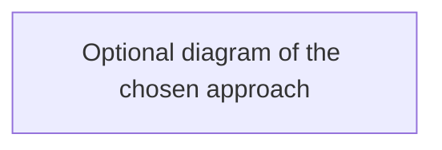

# ADR NNN — <Decision title>

**Status:** Accepted | Superseded by NNN
**Date:** YYYY-MM-DD

## Context
<!-- The problem and constraints. -->

## Decision
<!-- What we chose, in one or two sentences. -->

## Alternatives considered
- **<Option>** — why not.

## Consequences
- Good: ...
- Bad / trade-offs: ...
