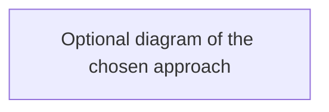

# ADR NNN — <Decision title>

**Status:** Accepted | Superseded by NNN
**Date:** YYYY-MM-DD

## Context
<!-- The problem and constraints. -->

## Decision
<!-- What we chose, in one or two sentences. -->

## Alternatives considered
- **<Option>** — why not.

## Consequences
- Good: ...
- Bad / trade-offs: ...

## Interview angle
- **At scale:** what changes at 10x and 1000x, and what breaks first.
- **Failure modes:** what happens when this part fails, and how we notice.
- **Likely follow-ups:** questions an interviewer would ask about this choice.
