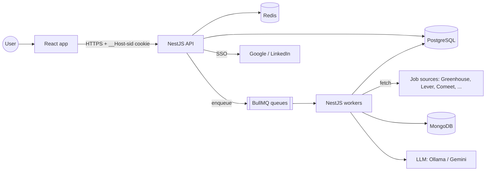
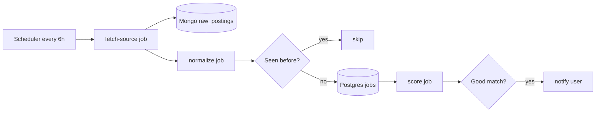

# Architecture overview

> Read this first. Each feature has its own detailed doc in `docs/features/`.

## TL;DR
A React app talks to a NestJS API using a secure session cookie. Background NestJS workers pull jobs from free sources on a schedule, store raw data in MongoDB, normalized data in PostgreSQL, score jobs against the user's CV with free/local AI, and notify the user.

## System map



## What each store holds

| Store | Holds | Why this store |
|---|---|---|
| PostgreSQL | users, identities, jobs, applications, contacts, drafts | Relational data, constraints, joins |
| MongoDB | raw source payloads, AI generation history | Varied shapes, append-heavy, re-processable |
| Redis | queues, sessions, dedupe keys, rate limits, cache | Fast, expiring keys |

See [ADR 001](adr/001-postgres-plus-mongodb.md) and [ADR 002](adr/002-bullmq-on-redis.md).

## Job pipeline (background)



## Monorepo layout

```
apps/api         NestJS REST API (ESM, port 3000, prefix /api)
apps/worker      NestJS BullMQ workers (no HTTP)
apps/web         React + Vite (port 5173, proxies /api to the API)
packages/shared  shared types, queue names, job payloads, zod request schemas (used by API and web)
e2e/             Playwright tests (smoke + auth journey)
```

Toolchain and testing levels: [ADR 005](adr/005-toolchain.md).

## Features

| Feature | Spec | Design doc | Status |
|---|---|---|---|
| Platform health (walking skeleton) | [000](specs/000-walking-skeleton.md) | [platform-health](features/platform-health.md) | Done |
| Auth (email + Google SSO, LinkedIn optional) | [001](specs/001-auth.md) | [auth](features/auth.md) | In progress |
| Job fetching | [002](specs/002-job-fetching.md) | — | Spec |
| Relevance scoring | — | — | Planned |
| Dashboard + application tracker | — | — | Planned |
| AI match explanations | — | — | Planned |
| Outreach drafts + follow-ups | — | — | Planned |
