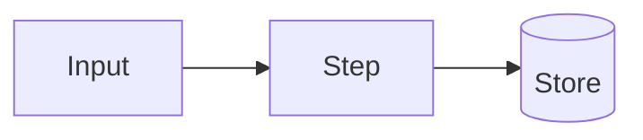
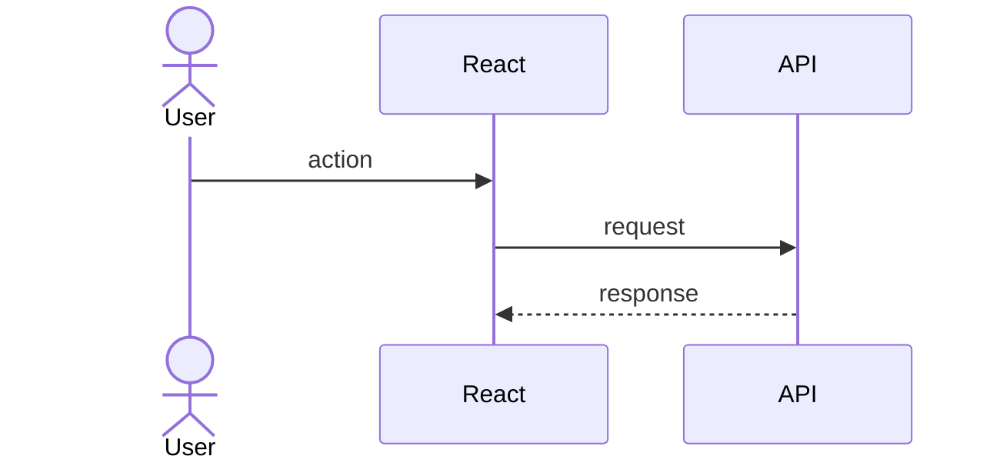
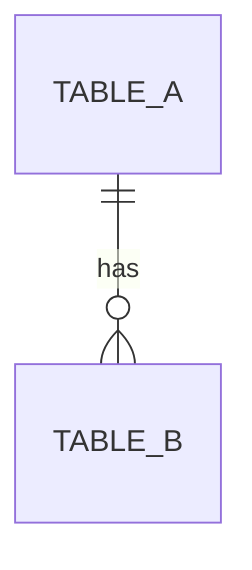

# Feature: <name>

**Status:** Designed | In progress | Done
**Spec:** [NNN](../specs/NNN-<feature>.md) · **Tasks:** [NNN](../tasks/NNN-<feature>.md)

## TL;DR
<!-- Max 3 lines: what it does and why it matters. -->

## How it flows

## Step by step

## Data model
<!-- Only if tables/collections change. -->

## Key decisions
- <decision> — [ADR NNN](../adr/NNN-<decision>.md)

## Failure handling
<!-- What happens when things go wrong: timeouts, retries, invalid input. -->

## Where the code lives
<!-- Short list of folders/files, so you can jump in if you need to. -->
