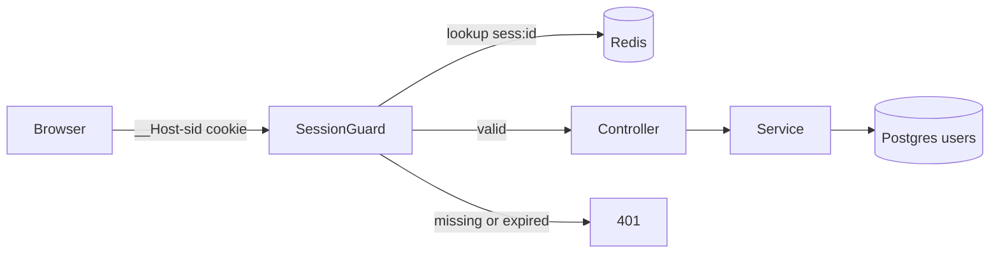
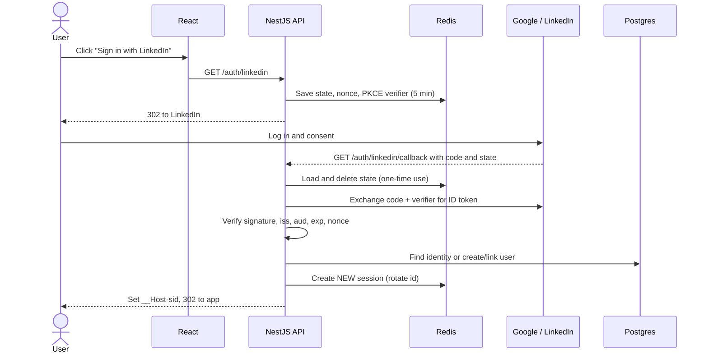
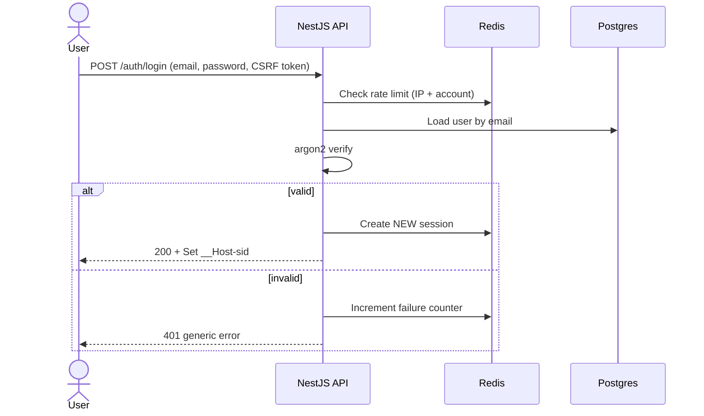
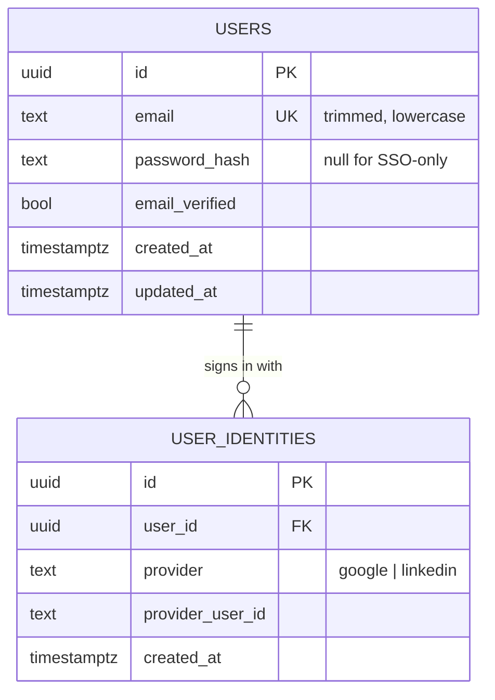

# Feature: Authentication

**Status:** In progress (`users` table and repository done; no endpoints yet)
**Spec:** [001](../specs/001-auth.md) · **Tasks:** [001](../tasks/001-auth.md)

## TL;DR
Users sign in with email/password, Google, or LinkedIn. The API keeps the session in Redis and gives the browser only a random id in a locked-down cookie, so nothing sensitive lives in the browser and logout is instant.

## How it flows

## SSO login step by step (Google / LinkedIn)

## Email login step by step

## Data model

Redis keys:
- `sess:<id>` → `{ userId, createdAt, lastSeenAt }`, TTL = idle timeout
- `user-sessions:<userId>` → set of session ids (for logout-all)
- `oidc:<state>` → `{ nonce, verifier, provider }`, TTL 5 min
- `rl:login:ip:<ip>`, `rl:login:acct:<email>` → failure counters, TTL 15 min

Built so far: `USERS` (migration `apps/api/migrations/*_create-users.sql`). A check constraint keeps emails trimmed and lowercase, so the unique constraint makes sign-up case-insensitive. `USER_IDENTITIES` comes with Google sign-in (card 001-07).

Unique constraint: `(provider, provider_user_id)` on `user_identities`.

## Key decisions
- Sessions in Redis, not JWT — [ADR 003](../adr/003-server-side-sessions.md)
- Schema changes as plain SQL migrations with node-pg-migrate — [ADR 006](../adr/006-migrations-node-pg-migrate.md)

## Failure handling
- Expired/unknown session → 401 → React redirects to `/login`.
- Invalid `state` or `nonce` on callback → 400, no session created.
- Provider email not verified and email already exists → refuse to link, show message.
- Rate limit exceeded → 429 with `Retry-After`.

## Where the code lives (planned)
- `apps/api/src/auth/` — controllers, services, guard, OIDC client, session store
- `apps/api/src/users/` — `UsersRepository` (built), identities repository (planned)
- `apps/api/migrations/` — SQL migrations
- `apps/web/src/features/auth/` — `useAuth`, login page, protected route
