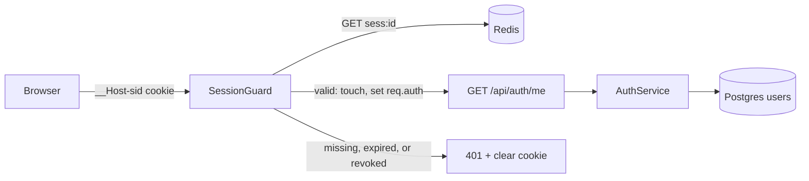
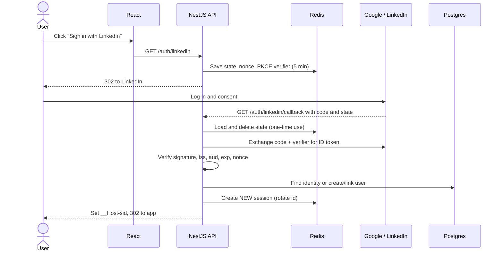
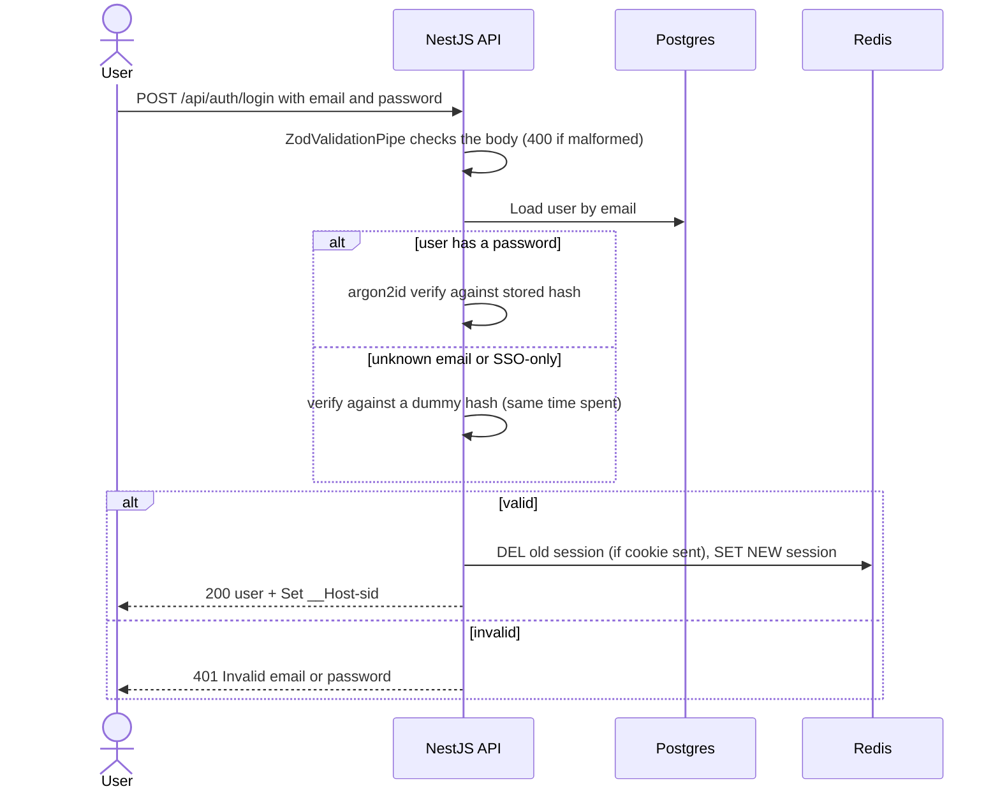
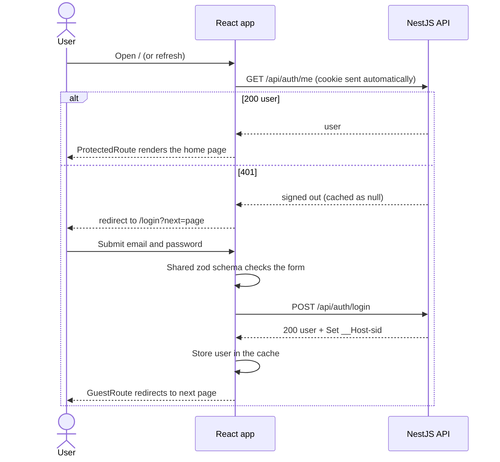
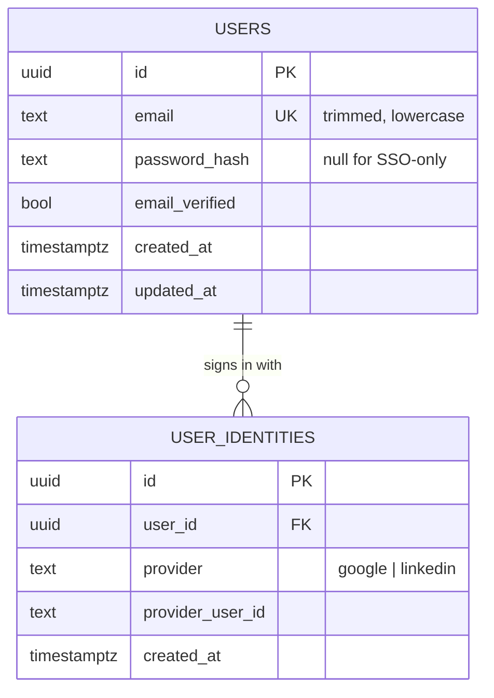

# Feature: Authentication

**Status:** In progress (email sign-up, login, logout: API and UI done; no logout-all, rate limits, CSRF, or SSO yet)
**Spec:** [001](../specs/001-auth.md) · **Tasks:** [001](../tasks/001-auth.md)

## TL;DR
Users sign in with email/password, Google, or LinkedIn. The API keeps the session in Redis and gives the browser only a random id in a locked-down cookie, so nothing sensitive lives in the browser and logout is instant.

## How it flows

A session ends after 7 days without use or 30 days after login, whichever comes first (`SESSION_IDLE_TTL_SECONDS`, `SESSION_ABSOLUTE_TTL_SECONDS`). Every request through the guard restarts the idle timer, never past the 30-day limit.

## SSO login step by step (Google / LinkedIn)

## Email login step by step

Sign-up (`POST /api/auth/signup`) is the same shape: validate (password 10–128 characters), hash with argon2id, insert the user (the unique constraint turns a taken email into 409), then start a new session and return 201. Logout (`POST /api/auth/logout`) deletes the session named by the cookie, clears the cookie, and always returns 204.

Card 001-06 adds rate limits (IP and account failure counters in Redis) and CSRF protection in front of these endpoints.

## In the browser

JavaScript can't read the HttpOnly cookie, so the React app asks the API who is signed in and caches the answer in React Query under `['auth', 'me']` (`null` = signed out). Route guards redirect from that cached answer; forms never navigate themselves.

| URL | Who can open it | Page |
|---|---|---|
| `/` | Signed in (else redirect to `/login`) | Home: "Signed in as …" and Log out |
| `/login`, `/signup` | Signed out (else redirect to `?next` or `/`) | Email and password forms |
| `/status` | Everyone | System status (dependency health, worker ping) |

`?next` only accepts same-site paths (`/jobs`, not `//evil.com`), so a login link can't send users to another site (open redirect). Logout removes every cached query, so the next person on the same browser never sees the previous user's data. The cached user counts as fresh for a minute; after that, returning to the tab re-checks `/auth/me`, so an expired session is noticed.

## Data model

Redis keys:
- `sess:<id>` → `{ userId, createdAt, lastSeenAt }`, TTL = idle timeout capped by the remaining absolute lifetime (built)
- `user-sessions:<userId>` → set of session ids (for logout-all, card 001-05)
- `oidc:<state>` → `{ nonce, verifier, provider }`, TTL 5 min
- `rl:login:ip:<ip>`, `rl:login:acct:<email>` → failure counters, TTL 15 min

Built so far: `USERS` (migration `apps/api/migrations/*_create-users.sql`). A check constraint keeps emails trimmed and lowercase, so the unique constraint makes sign-up case-insensitive. `USER_IDENTITIES` comes with Google sign-in (card 001-07).

Unique constraint: `(provider, provider_user_id)` on `user_identities`.

## Key decisions
- Sessions in Redis, not JWT — [ADR 003](../adr/003-server-side-sessions.md)
- Schema changes as plain SQL migrations with node-pg-migrate — [ADR 006](../adr/006-migrations-node-pg-migrate.md)
- Passwords hashed with argon2id via `@node-rs/argon2` — [ADR 007](../adr/007-password-hashing-argon2id.md)
- Request bodies validated with zod schemas in a Nest pipe — [ADR 008](../adr/008-request-validation-zod-pipe.md)
- React Router, auth state in React Query, and forms validated with the same shared zod schemas — [ADR 009](../adr/009-frontend-routing-auth-state-forms.md)
- Duplicate email at sign-up returns 409, which reveals that the email is registered. Accepted for usability; rate limits (card 001-06) slow down anyone harvesting emails this way. Login never reveals it.

## Failure handling
- Malformed body (bad email, password too short or long, missing fields) → 400 `ValidationError` listing each problem.
- Email already registered at sign-up → 409 `EmailTakenError`, no session.
- Wrong password, unknown email, or SSO-only account at login → the same 401 "Invalid email or password", after the same hashing work.
- Missing, expired, unknown, or revoked session → 401 with a generic message; a dead cookie is cleared. React redirects to `/login`.
- In the browser: invalid fields show the schema's message under the input before any request; API errors (401, 409, 500) show above the submit button. If `/auth/me` itself fails (API down), protected pages show the error instead of the login page.
- Session whose account was deleted → session destroyed, 401.
- Invalid `state` or `nonce` on callback → 400, no session created.
- Provider email not verified and email already exists → refuse to link, show message.
- Rate limit exceeded → 429 with `Retry-After`.

## Where the code lives
- `apps/api/src/auth/` — `SessionStore`, `SessionGuard`, cookie helpers, `@CurrentUser()`, `GET /auth/me`, `POST /auth/logout`, `PasswordHasher`, `PasswordAuthService` and controller for sign-up and login (built); OIDC client (planned)
- `apps/api/src/http/` — `ZodValidationPipe` and `DomainErrorFilter`
- `apps/api/src/users/` — `UsersRepository` (built), identities repository (planned)
- `apps/api/migrations/` — SQL migrations
- `packages/shared/src/auth.ts` — `signupSchema`, `loginSchema`, request and response types (used by API and web)
- `apps/web/src/features/auth/` — `useAuth`, login/sign-up/logout mutations, `CredentialsForm`, `ProtectedRoute`, `GuestRoute`, `?next` checks
- `apps/web/src/AppRoutes.tsx` — every URL; pages in `apps/web/src/pages/`
- `e2e/auth.spec.ts` — the full journey in a real browser
