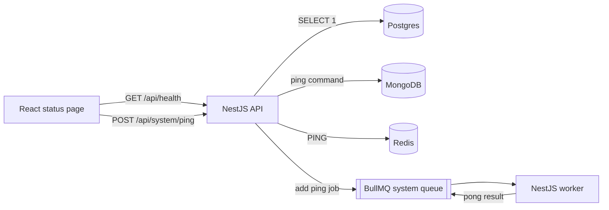
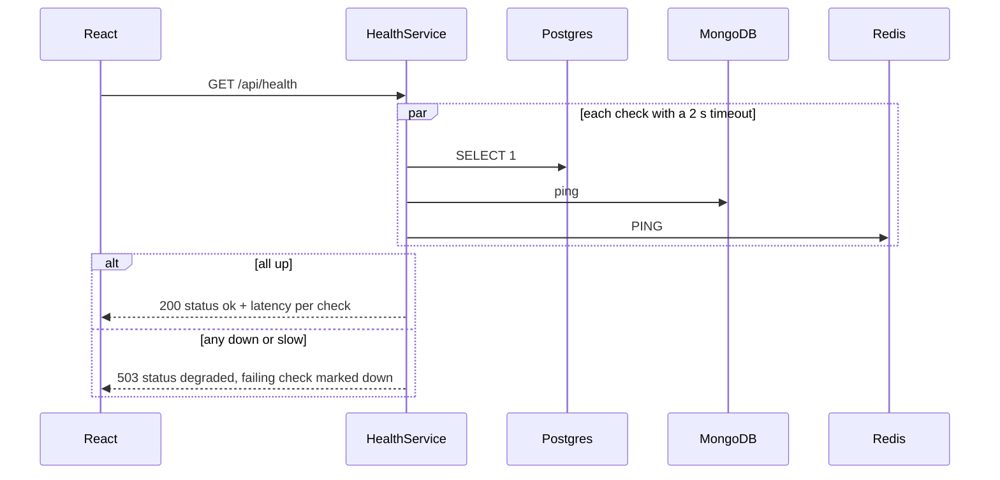
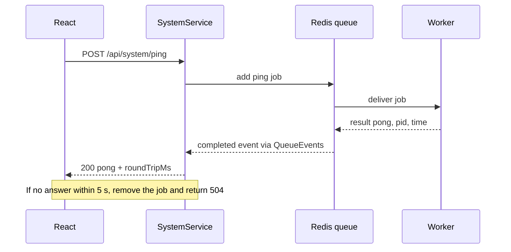
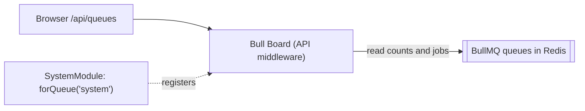

# Feature: Platform health (walking skeleton)

**Status:** Done
**Spec:** [000](../specs/000-walking-skeleton.md) · **Tasks:** [000](../tasks/000-walking-skeleton.md)

## TL;DR
A status page proves the whole stack works: the API checks Postgres, MongoDB, and Redis, and a "ping" job travels through the BullMQ queue to the worker and back. If anything breaks, the page and `GET /api/health` say exactly what.

## How it flows

## Health check step by step

## Worker ping step by step

## Queue dashboard (development only)

Bull Board shows every BullMQ queue at `/api/queues` (also through the web app: http://localhost:5173/api/queues): jobs waiting, active, completed, and failed, with retry and delete buttons.

It is mounted only when `NODE_ENV` is not `production`, because it can change jobs and has no login yet. Each module that registers a queue also adds it to the dashboard with `QueueDashboardModule.forQueue(name)`.

## Key decisions
- Raw drivers (`pg`, `mongodb`, `ioredis`), no ORM yet — [ADR 005](../adr/005-toolchain.md)
- BullMQ on Redis — [ADR 002](../adr/002-bullmq-on-redis.md)
- Same-origin `/api` through the Vite proxy so future auth cookies stay first-party — [ADR 003](../adr/003-server-side-sessions.md)

## Failure handling
- A dependency that errors or exceeds 2 s is reported `down` with `unavailable` or `timeout`; details go to logs only, never to the response.
- Clients connect lazily, so the API starts even when a database is down.
- Unknown job names fail permanently in the worker (no retries).
- Missing or invalid env vars stop the API/worker at startup with a list of problems.

## Where the code lives
- `apps/api/src/health/` — checks, service, controller
- `apps/api/src/system/` — ping endpoint, QueueEvents, WorkerTimeoutError
- `apps/api/src/queue-dashboard/` — Bull Board, development only
- `apps/api/src/infra/` — Postgres/Mongo/Redis clients (composition root)
- `apps/worker/src/system/` — `SystemProcessor`, `PingService`
- `apps/web/src/features/system/` — `HealthPanel`, `PingPanel`, hooks
- `e2e/smoke.spec.ts` — the end-to-end proof
