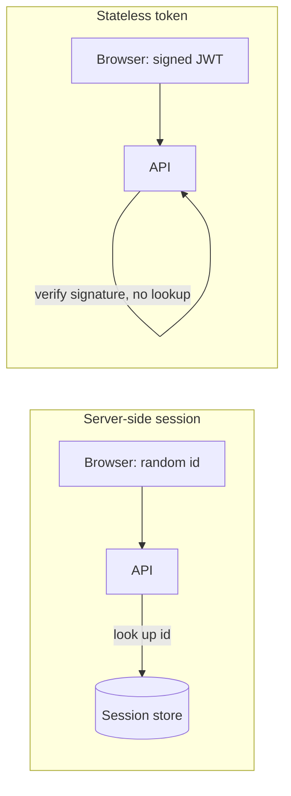

# Auth and sessions

## TL;DR
After login, the server must recognize the browser on every request. Either the server remembers (a **session**: the browser holds only a random id) or the browser carries signed proof (a **token**, usually a JWT). Sessions make logout instant; tokens avoid a lookup per request.

## Concepts

**Stateful session vs stateless token**

- **Session:** the id means nothing by itself; the store says who it belongs to. Revoke = delete the record.
- **JWT:** the token holds the user id and expiry, signed by the server. Any server with the key can verify it without a lookup, but it stays valid until it expires, so revoking it early needs a denylist (which is a lookup again).

**Cookie flags** (where the browser keeps the id)

| Flag | Protects against |
|---|---|
| `HttpOnly` | Scripts reading the cookie (XSS stealing the session) |
| `Secure` | Sending it over plain HTTP (network sniffing). `localhost` counts as secure in Chromium and Firefox. |
| `SameSite=Lax` | Other sites sending it on cross-site POSTs (most CSRF) |
| `__Host-` prefix | Subdomains setting or overwriting it (requires `Secure`, `Path=/`, no `Domain`) |

**Expiry**
- **Idle timeout:** ends a session nobody used for N days. Restarted on every use.
- **Absolute timeout:** ends a session N days after login, however active. Limits how long a stolen id is useful.
- One store TTL can enforce both: `min(idle left, absolute left)`.

**Attacks to name**
- **XSS:** injected script acts as the user. `HttpOnly` stops it from stealing the id, not from making requests.
- **CSRF:** another site makes the browser send a request with the user's cookie. Defenses: `SameSite`, a CSRF token, and checking `Origin`.
- **Session fixation:** an attacker plants a known session id before login. Defense: issue a new id at login (rotation).

## In this project
Sessions in Redis behind a `__Host-sid` cookie, 7 days idle and 30 days absolute. Why: [ADR 003](../adr/003-server-side-sessions.md). How it flows: [auth feature doc](../features/auth.md). Code: `apps/api/src/auth/session.store.ts`, `session.guard.ts`, `cookie.ts`.

## Alternatives
- **JWT in `localStorage`:** simple for SPAs and mobile, but any XSS can read it, and it can't be revoked early.
- **JWT in an HttpOnly cookie:** fixes theft by script; revocation still needs server state.
- **Short access JWT (5-15 min) + rotating refresh token:** the common hybrid. Services verify the JWT without a lookup; only refresh hits the store. Wins with many services or at the edge.
- **In-memory sessions on the API server:** fastest, but lost on restart and break with more than one server unless the load balancer uses sticky sessions.
- **Hosted auth (Auth0, Clerk, Cognito):** fast to ship and handles MFA and SSO; costs money and hides the mechanics.

## At scale
- **10x:** one Redis handles this easily (a single instance serves ~100k simple operations per second).
- **1000x:** every request writes (`touch`). Reduce writes by touching only when `lastSeenAt` is older than a minute. Shard sessions across a Redis Cluster by id.
- **Redis down:** nobody can be authenticated, so auth fails closed (401). Use a replicated or managed Redis with failover.
- **Many services or regions:** a central store adds latency per hop. This is where the JWT hybrid wins: verify locally, revoke by keeping access tokens short.

## Practice questions
1. **Sessions or JWT for a new web app? Defend it.** A strong answer covers: revocation needs, XSS exposure of storage, number of services verifying identity, the lookup cost, and the hybrid option.
2. **How do you log a user out of all devices?** Covers: an index of session ids per user (`user-sessions:<userId>`), deleting them all, and with JWTs a per-user "valid after" timestamp or denylist.
3. **Why both an idle and an absolute timeout?** Covers: idle limits abandoned sessions; absolute limits the lifetime of a stolen but actively used id.
4. **What does `SameSite=Lax` not protect against?** Covers: same-site attackers (a compromised subdomain), top-level GET navigations that change state, older browsers; hence a CSRF token and `Origin` checks.
5. **Your session store has 1 ms p99 latency, and traffic grows 1000x. What breaks first?** Covers: write load from `touch`, memory per session, a single point of failure, then sharding and replication.
