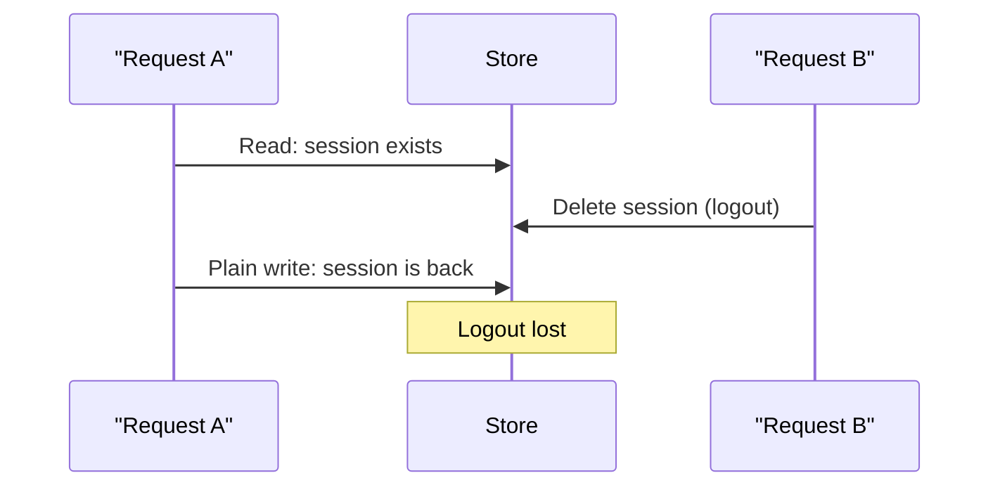

# Concurrency and atomicity

## TL;DR
When two requests touch the same data at the same time, the result can depend on which one wins (a **race condition**). The fix is to make "check and change" one **atomic** step, inside the database or Redis, instead of checking in app code and changing later.

## Concepts

**Atomic operation:** happens as one indivisible step; nothing else can run in the middle, and it either fully happens or not at all.

**Race condition:** the outcome depends on timing between concurrent operations.

**Check-then-act (TOCTOU, "time of check to time of use"):** code checks a condition, then acts on it later, when it may no longer be true.

**Conditional write (compare-and-set):** a single command that writes only if a condition still holds, checked by the store itself.

| Store | Write only if missing | Write only if present |
|---|---|---|
| Redis | `SET key value NX` | `SET key value XX` |
| SQL | `INSERT` with a unique constraint (fails on duplicate) | `UPDATE ... WHERE id = $1` (0 rows if gone) |

An **upsert** (`INSERT ... ON CONFLICT DO UPDATE`, or a plain Redis `SET`) is "write either way", which is exactly what brings deleted data back in the race above.

**ACID** (guarantees of a database transaction)
- **Atomicity:** all of the transaction or none of it.
- **Consistency:** constraints always hold (unique, foreign keys, checks).
- **Isolation:** concurrent transactions don't see each other's half-done work. Levels: read committed (Postgres default), repeatable read, serializable.
- **Durability:** once committed, it survives a crash.

Redis is atomic per command (and per `MULTI`/`EXEC` or Lua script), but durability depends on its persistence settings.

## In this project
- `SessionStore.create` uses `SET ... NX`; `touch` uses `SET ... XX` so a late request can't revive a logged-out session (`apps/api/src/auth/session.store.ts`, design in [ADR 003](../adr/003-server-side-sessions.md)).
- Duplicate emails are prevented by a unique constraint, not by "check, then insert" in code (`apps/api/migrations/*_create-users.sql`, `users.repository.ts`). Two simultaneous sign-ups can't both succeed.

## Alternatives
- **Check in app code, then write:** simple but racy. Only safe with a lock or a constraint behind it.
- **Locks:** `SELECT ... FOR UPDATE` in SQL, or a Redis lock (`SET lock NX PX`). Correct, but slower and risks deadlocks or stuck locks; use when a whole multi-step operation must be exclusive.
- **Optimistic concurrency:** store a `version` column; `UPDATE ... WHERE version = $old`; retry on 0 rows. Good when conflicts are rare.
- **Serializable isolation:** the database detects conflicts and aborts one transaction; the app must retry.
- **Single writer:** route all changes for one key through one queue or worker, so they never overlap.

## At scale
- Constraints and conditional writes keep working across many API servers, because the store decides. App-level locks in memory do not.
- Distributed locks across Redis nodes are hard to get right (clock drift, failover); prefer idempotent operations and conditional writes.
- Hot keys (one row everyone updates) serialize on their lock; split them (counters per shard) or queue the writes.

## Practice questions
1. **Two users sign up with the same email at the same moment. What stops a duplicate?** A strong answer covers: a unique constraint in the database, mapping the violation to a 409, and why a "find first" check in code is not enough.
2. **What's the difference between an upsert and a conditional update, and when does it matter?** Covers: upsert creates missing rows; a conditional update never does; the logout race as the example.
3. **When would you use optimistic vs pessimistic locking?** Covers: conflict rate, lock duration, retries vs blocking, deadlocks.
4. **Is Redis ACID?** Covers: atomic per command and per `MULTI`/Lua, isolation by its single-threaded command execution, durability depends on RDB/AOF settings, no rollback in `MULTI`.
5. **How do you make a "charge the card" job safe to retry?** Covers: an idempotency key with a unique constraint, recording the result, and returning the stored result on a repeat.
