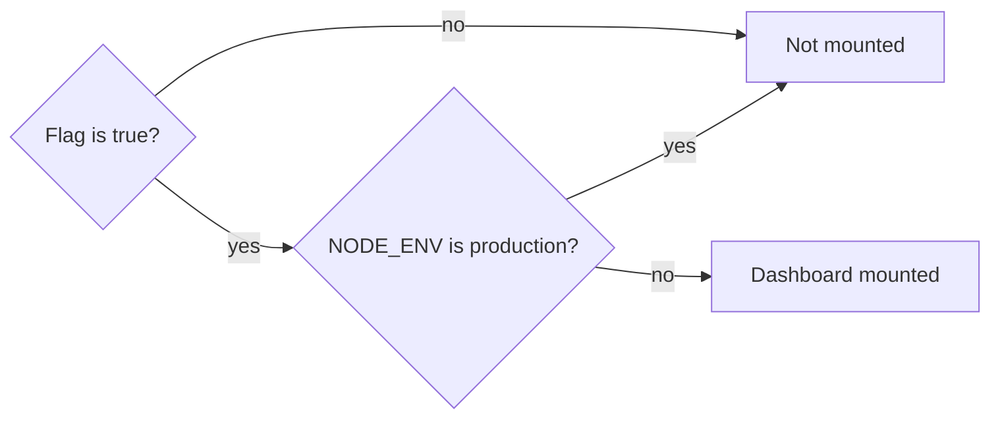

# Feature flags and secure defaults

## TL;DR
A **feature flag** turns one feature on or off without changing code. For anything dangerous (admin tools, debug endpoints), make it **fail-closed**: off unless explicitly turned on, so a forgotten setting is safe. Add a second, independent check (**defense in depth**) so one mistake is never enough.

## Concepts

**Kinds of flags**

| Kind | Purpose | Example |
|---|---|---|
| Ops toggle | Turn a technical feature on or off per environment | Queue dashboard, debug endpoints |
| Release toggle | Merge unfinished work and keep it hidden | A new page before launch |
| Experiment toggle | Show variants to different users | A/B tests |
| Permission toggle | On only for some users | Beta features for admins |

- **Static flags** are read from env or config at startup (free, needs a restart). **Dynamic flags** come from a service (LaunchDarkly, Unleash, GrowthBook) and change at runtime.
- Keeping config in the environment, not in code, is one of the "12-factor app" principles.

**Fail-open vs fail-closed**

| Design | Someone forgets the setting | Result |
|---|---|---|
| "Off when `NODE_ENV=production`" (and `NODE_ENV` defaults to development) | Feature **on** | Fail-open |
| "On only when `FEATURE_ENABLED=true`" | Feature **off** | Fail-closed |

**One variable per decision.** `NODE_ENV` answers "what kind of environment is this?" and also changes library behavior. A feature flag answers "do we want this feature here?" Mixing them breaks as soon as there are more than two environments (CI, staging, demo).

**Defense in depth:** several independent protections, so one slip is not enough, like a gas knob you must push *and* turn.

**Protecting internal tools:** never expose them publicly; put them behind the same login with a role check, or reach them only through an internal network or VPN. If the tool runs as middleware, framework guards don't protect it (see [NestJS building blocks](nestjs-building-blocks.md)).

## In this project
The queue dashboard (`apps/api/src/queue-dashboard/`) mounts only when `QUEUE_DASHBOARD_ENABLED=true` and `NODE_ENV` is not `production`; the flag defaults to false in `apps/api/src/config/env.ts`. See the [platform-health feature doc](../features/platform-health.md). The first version was fail-open (off only in production), found in the card's code lesson and fixed before merge.

## Alternatives
- **Only `NODE_ENV`, defaulting to `production`:** fail-closed for the whole app, but couples the feature to the environment and makes every developer set `NODE_ENV=development`.
- **A flag service:** per-user targeting and runtime changes, at the cost of a dependency and a network call (with caching and a safe default when it's down).
- **Build-time removal:** compile the feature out of production builds entirely. Strongest, but needs separate builds.

## At scale
- Flags pile up: each one doubles the possible combinations. Give every flag an owner and a removal date; delete release flags after launch.
- With a flag service, decide the default when it's unreachable (fail-closed for risky features).

## Practice questions
1. **"How do you make sure an admin dashboard never ends up public?"** A strong answer covers: off by default, explicit opt-in, a second check (environment or network), auth with a role check, and not relying on people remembering a setting.
2. **"Why not just check `NODE_ENV`?"** Covers: environment vs feature decision, more than two environments, fail-open defaults, explicit deploy config.
3. **"What's the downside of many feature flags?"** Covers: combinatorial testing, stale flags, flag debt, ownership and cleanup.
