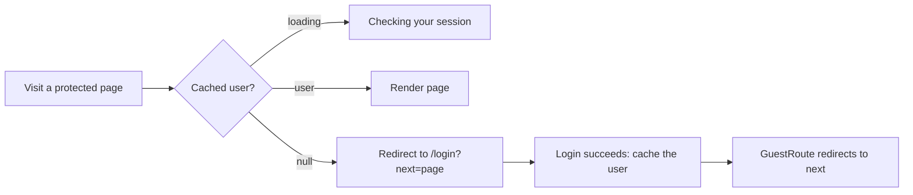

# Frontend auth, routing, and forms

## TL;DR
In a single-page app the browser changes pages without reloading; a **router** maps URLs to components. "Who is signed in" is **server state**: the server owns it, and the UI keeps a cached copy and re-checks it. Route guards redirect based on that copy. Validate forms in the browser for a better experience, and on the server for security.

## Concepts

**Client-side routing.** The server sends one `index.html`; JavaScript swaps components when the URL changes (`history.pushState`) and listens for back/forward (`popstate`). No full page reload.

| Term | Meaning |
|---|---|
| **SPA** | Single-page application: one HTML page, routing done in the browser |
| **History fallback** | The server returns `index.html` for any unknown path, so refreshing on `/login` works. Vite does it; production servers (nginx, CDN) must be configured for it. |
| **Layout route** | A route without its own URL that wraps child routes; our `ProtectedRoute` and `GuestRoute` render `<Outlet />` or redirect |
| **`replace` navigation** | Redirect without adding a history entry, so "Back" doesn't bounce into the redirect again |
| **Code splitting** | Load each page's code only when it's visited (`React.lazy`) |

**Server state vs client state**

| | Server state | Client state |
|---|---|---|
| Owner | The server (database, Redis) | The browser |
| Examples | Current user, job list | Is a menu open, form input |
| Can go stale? | Yes: someone else can change it | No |
| Tool | A cache with refetching (React Query, SWR) | `useState`, context, Zustand |

Auth looks like client state ("am I logged in?") but is server state: the session can expire or be revoked on the server at any time. So the UI caches `GET /auth/me` and re-checks it, instead of storing a flag.

**Stale time.** How long cached data counts as fresh. While fresh, React Query serves it without asking the server; once stale, it refetches when a component mounts or the tab regains focus. A short stale time notices changes sooner but sends more requests.

**Route guard flow:**

**Open redirect.** A login page that blindly follows `?next=` can be abused: `https://ourapp.com/login?next=https://evil.com` looks trustworthy, and after a real login the user lands on a phishing copy. Accept only same-site paths: must start with `/`, but not `//` or `/\` (browsers treat those as another host).

**Validation on both sides.** Browser checks give instant feedback and save a round trip, but anyone can skip them (curl, devtools). The server check is the real security boundary. Sharing one schema keeps the rules and messages from drifting.

**Controlled vs uncontrolled inputs.** Controlled: React state holds the value and every keystroke re-renders. Uncontrolled: the DOM holds the value and you read it when needed. react-hook-form registers uncontrolled inputs by ref, so big forms stay fast.

**Security reminders for SPAs.** Never keep tokens in `localStorage` (any XSS can read it); an HttpOnly cookie is invisible to scripts. Clear cached data on logout so the next person on a shared computer doesn't see it. Hiding a page in the UI is not authorization: the API must check every request.

## In this project
The app's URLs live in `apps/web/src/AppRoutes.tsx`; the guards, hooks, and forms in `apps/web/src/features/auth/`; the shared schemas in `packages/shared/src/auth.ts`. Why these libraries: [ADR 009](../adr/009-frontend-routing-auth-state-forms.md). How it flows: [auth feature doc](../features/auth.md#in-the-browser).

## Alternatives
- **Server-side rendering** (Next.js, Remix, React Router framework mode): the server checks the session before sending HTML, so there's no "Checking your session…" flash, at the cost of running a Node server for the frontend.
- **Auth in context or a global store:** fine when there is no server-state library; you hand-write loading and refresh.
- **Tokens in memory plus a refresh-token cookie:** common with JWT APIs; more moving parts than a session cookie.

## At scale
- Many data calls: add a global 401 handler that clears the cached user when any request finds the session gone.
- Many pages: split code per route and prefetch likely next pages.
- Many teams and clients (web, mobile): share contracts through OpenAPI or protobuf generation rather than a TypeScript package.

## Practice questions
1. **"How does a React app know the user is logged in if the cookie is HttpOnly?"** A strong answer covers: asking an endpoint like `/me`, caching the answer, treating 401 as "signed out", re-checking on focus or on any 401.
2. **"Where would you store auth state in React?"** Covers: server state vs client state, a query cache as the source of truth, why not localStorage.
3. **"What is an open redirect and how do you prevent it?"** Covers: phishing after a real login, allow-listing same-site paths, `//` and `/\` tricks.
4. **"You validate in the browser. Do you still need server validation?"** Covers: the browser is untrusted, the server is the boundary, shared schemas to avoid drift.
5. **"Why does refreshing on `/login` give a 404 in production but not in dev?"** Covers: history fallback, configuring the web server or CDN to return `index.html`.
