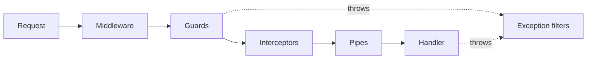

# NestJS building blocks

## TL;DR
Nest apps are **modules** of **providers** wired by **dependency injection**. Every request passes a fixed lifecycle (middleware, guards, interceptors, pipes, handler, filters). Reusable libraries plug in as **dynamic modules** (`forRoot` once, `forFeature` per module).

## Concepts

**Building blocks**

| Term | What it is |
|---|---|
| Module | Groups related providers and controllers; declares what it imports and exports |
| Controller | Handles HTTP routes; should stay thin |
| Provider | Anything Nest creates and injects: services, repositories, clients, config values |
| Dependency injection | Constructors list what they need; Nest builds and passes it in |
| Injection token | The key a provider is registered under: a class, or a `Symbol` for interfaces and plain values (interfaces vanish at runtime) |
| Factory provider | `useFactory`: a function that builds a provider, often from config |
| Global module | Its exports are available everywhere without importing it |

**Request lifecycle**

- **Middleware** runs first for matching paths and knows nothing about handlers. Anything mounted as middleware (like an Express router) **skips guards, pipes, and filters**, so `@UseGuards` cannot protect it; protect it with middleware.
- **Guards** decide yes or no. Throw a typed error for the right status (a guard that returns `false` gives 403).
- **Pipes** validate and transform input. **Interceptors** wrap the handler (timing, mapping). **Filters** turn thrown errors into responses.

**Dynamic modules:** a static `@Module` has fixed contents; a dynamic module is a function returning a module definition built from options.
- `forRoot(options)`: once, in the root module; creates the shared instance (often `global: true`).
- `forFeature(...)` / `registerQueue(...)`: in each feature module; adds that module's part to the shared instance.
- Modules can be returned as **promises**; `ConditionalModule.registerWhen` uses this to decide after `.env` has loaded.

**Adapter pattern** (seen in `@bull-board/*` and `@nestjs/platform-express`): one core with no framework knowledge, plus thin adapters per framework or library, so the core never changes when you switch.

## In this project
- Composition roots: `apps/api/src/app.module.ts`, `apps/api/src/infra/infra.module.ts` (global, tokens `PG_POOL`, `MONGO_CLIENT`, `REDIS`).
- Guard and typed errors: `apps/api/src/auth/session.guard.ts`, `apps/api/src/http/domain-error.filter.ts`.
- Dynamic modules: `BullModule.forRootAsync` + `registerQueue`; `QueueDashboardModule.forRoot` + `forQueue` (`apps/api/src/queue-dashboard/`), mounted as middleware, which is why it needs its own protection ([feature flags](feature-flags.md)).
- The worker uses `NestFactory.createApplicationContext`: DI and modules with no HTTP server.

## Alternatives
- **Express or Fastify without a framework:** less magic and faster start, but you build DI, structure, and conventions yourself.
- **Other DI frameworks** (InversifyJS, tsyringe): DI without Nest's module system.
- **Hono / Elysia:** lightweight and edge-friendly, with fewer built-in patterns.

## At scale
- Module boundaries become service boundaries if a module is extracted (see [system shape](system-shape.md)).
- Request-scoped providers are created per request and cost performance; keep providers singletons unless they truly need request state.

## Practice questions
1. **"Why can't a guard protect a route mounted as middleware?"** A strong answer covers: lifecycle order, guards wrap controller handlers only, protect with middleware or network isolation.
2. **"Why use a `Symbol` token instead of an interface for injection?"** Covers: TypeScript types are erased at runtime; Nest needs a runtime key.
3. **"`forRoot` vs `forFeature`?"** Covers: one shared instance configured once, per-module registration, cohesion (a module owns its parts).
4. **"What is the adapter pattern, and where have you used it?"** Covers: a framework-agnostic core plus thin adapters; swapping frameworks without changing the core.
