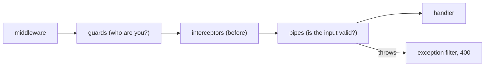

# Password storage, login safety, and input validation

## TL;DR
Never store passwords, only a **slow, salted, memory-hard hash** (argon2id), so a leaked database is expensive to crack. Login must not reveal which emails exist: give **the same error and the same response time** for "no such user" and "wrong password". Give a **new session id on every login**. Validate every request body at runtime, because TypeScript types vanish when the code runs.

## Concepts

**Hashing vs encryption.** Encryption can be reversed with a key; a hash cannot. For passwords we never need the original back. We hash the login attempt the same way and compare.

**Why fast hashes are wrong.** SHA-256 is built for speed: a GPU computes billions per second, so a leaked table of SHA-256 passwords falls to a dictionary attack in hours. Password hashes are built to be slow on purpose.

| Term | Meaning |
|---|---|
| **Salt** | Random bytes (16 here) mixed into each hash. The same password gives different hashes, so precomputed tables (rainbow tables) are useless and every user must be attacked separately. Not secret; stored next to the hash. |
| **Pepper** | A secret added to every hash, kept outside the database (env or a vault). A database-only leak can't be cracked without it. Optional; we don't use one yet. |
| **Work factor / cost** | How expensive one hash is. Raised over time as hardware gets faster. |
| **Memory-hard** | Each guess needs lots of RAM (19 MiB here). GPUs have thousands of cores but little memory per core, so this cuts their advantage. |
| **KDF** | Key derivation function: the family argon2, scrypt, bcrypt, and PBKDF2 belong to. |
| **PHC string** | The self-describing storage format: algorithm, version, parameters, salt, and hash in one string. |

A PHC string, field by field:

```text
$argon2id$v=19$m=19456,t=2,p=1$ZnWhb00AnnVOFcI6AZ2Ipg$rF5TevMtfupNk8/S6Vw/Qu7dvvQXJsWvNNBymeVZpwM
 algorithm  version  memory KiB, passes, lanes   salt (base64)          hash (base64)
```

The salt is random only once, at sign-up. Login doesn't make a new one: `verify` reads the salt and parameters from the stored string, hashes the typed password with them, and compares. A new salt appears only when a new hash is created (sign-up or a password change).

Because the parameters live inside each hash, we can raise the cost later: old hashes still verify with their own parameters, and on a successful login we can rehash with the new cost (`parseOptions` in `@node-rs/argon2` shows the old ones).

**The algorithms, oldest to newest**

| Algorithm | Year | Memory-hard? | Notes |
|---|---|---|---|
| PBKDF2 | 2000 | No | Required by FIPS; needs about 600,000 iterations today |
| bcrypt | 1999 | A little (4 KiB) | Proven; truncates passwords after 72 bytes |
| scrypt | 2009 | Yes | Built into Node; memory and CPU tied together |
| argon2id | 2015 | Yes | Won the Password Hashing Competition; OWASP's first choice |

argon2 has three variants: **argon2d** (best against GPUs, but leaks timing), **argon2i** (safe against timing side channels, weaker against GPUs), and **argon2id** (a hybrid, the recommended default).

**User enumeration.** If login says "no such user" for one email and "wrong password" for another, an attacker learns which emails have accounts, and then targets them with phishing or password spraying. The defense has two parts:
1. **The same message:** "Invalid email or password" for both cases.
2. **The same timing:** a missing user would skip the hash (tens of milliseconds) and answer faster, which is measurable. So we verify against a dummy hash anyway. Comparing the hash itself must also be constant-time (the library does this).

Sign-up is the hard case. "Email already registered" leaks the same fact. The fully safe option is to always say "check your email" and send a message either way, which needs email delivery. Most products accept the leak and rate-limit sign-up instead.

**Session fixation.** An attacker gets a valid session id (for example by visiting the site), plants it in the victim's browser, and waits for the victim to log in. If the id stays the same after login, the attacker's copy is now signed in. The fix: **create a new id on every login and delete the old one** (rotation). Also rotate when privileges change, for example on becoming an admin.

**Runtime validation.** `body: CredentialsRequest` in TypeScript is a promise the compiler trusts but never checks: the JSON could be anything. A **schema** (zod, Joi, JSON Schema, class-validator) checks the shape when the code runs. That matters for security, because a field that should be a string might arrive as an object (`{"$gt": ""}` is a classic NoSQL injection). The rule: **parse, don't validate**. Turn unknown input into a typed value once, at the edge, and the rest of the code can trust it.

**Where a NestJS pipe runs:**



## In this project
- `apps/api/src/auth/password-hasher.ts`: argon2id with m=19456, t=2, p=1 via `@node-rs/argon2`, plus `verifyDummy` for timing ([ADR 007](../adr/007-password-hashing-argon2id.md)).
- `apps/api/src/auth/password-auth.service.ts`: sign-up and login. Unknown email, SSO-only account, and wrong password all give the same 401 after the same work.
- `apps/api/src/auth/auth.service.ts`: `startSession` deletes the browser's old session and creates a new id (rotation).
- `apps/api/src/http/zod-validation.pipe.ts` and `auth/auth.schemas.ts`: zod schemas checked against the shared types with `satisfies` ([ADR 008](../adr/008-request-validation-zod-pipe.md)).
- Sign-up returns 409 for a taken email: an accepted enumeration trade-off ([feature doc](../features/auth.md)).

## Alternatives
- **Outsource auth** (Auth0, Cognito, Clerk): no hashes stored at all, at the cost of money and control.
- **Passwordless** (magic links, passkeys/WebAuthn): nothing to leak or reuse; passkeys also stop phishing. Likely the long-term direction.
- **Validation with class-validator:** decorated DTO classes, the NestJS default; it also generates OpenAPI docs.

## At scale
- Hashing is CPU and memory heavy on purpose, so login floods are a cheap denial-of-service attack. Rate-limit before hashing, and consider a separate pool or service for hashing.
- Credential stuffing (leaked passwords from other sites) is the main real attack. Defenses: rate limits per IP and account, checking against breached-password lists (HaveIBeenPwned's k-anonymity API), and MFA.
- Rotating a pepper or raising the cost needs a plan: rehash on the next successful login, and force a reset for dormant accounts.

## Practice questions
1. **"How would you store passwords?"** A strong answer covers: argon2id or bcrypt (not SHA), a per-user salt, a tuned cost, a self-describing format, rehash on login, and optionally a pepper.
2. **"An attacker can tell which emails are registered. How, and how do you stop it?"** Covers: different messages, timing differences, the sign-up and password-reset flows, and rate limits.
3. **"What is session fixation?"** Covers: a planted id, rotation on login and privilege change, and HttpOnly plus `__Host-` cookies.
4. **"Why validate if you have TypeScript?"** Covers: types are erased at runtime, untrusted input, injection, and parsing at the boundary.
