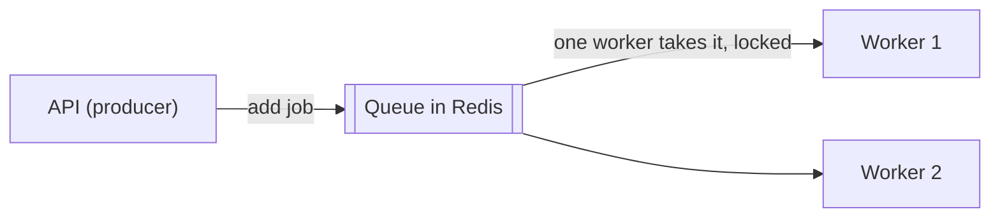

# System shape

## TL;DR
Start as a **modular monolith** with clean module boundaries; split out services only for team or scaling reasons. Move slow or flaky work to a **separate worker** fed by a **queue**. Keep producer and consumer contracts in a **shared types package**, and remember that types don't exist at runtime.

## Concepts

**Monolith vs microservices**
- **Modular monolith:** one deployable app, split into modules with explicit imports and exports. Cheap to run, transactions work, refactoring is easy.
- **Microservices:** one service per area, each with its own database. Wins with many teams (Conway's law: systems mirror team structure) or very different scaling needs. Costs: network failures, no cross-service transactions (eventual consistency, sagas), N pipelines, distributed tracing.

**Producer / consumer with a job queue**

- **Job queue:** "do this work", handled by exactly one consumer. **Pub/sub:** "this happened", delivered to every subscriber.
- A queue decouples in **time** (work runs later), **capacity** (bursts wait instead of overloading anything), and **failure** (a crashing job can't take the API down).
- Durability: queued jobs survive restarts; in-memory "fire and forget" work does not.

**Scheduled work with several instances:** an in-memory cron in each of N instances fires N times. Fix it with a schedule stored once in a shared store (BullMQ repeatable jobs), leader election, a distributed lock, or one dedicated scheduler, plus idempotent jobs as a safety net.

**Walking skeleton:** the thinnest end-to-end version touching every part (UI, API, stores, queue, worker, CI, E2E) before any feature. Then grow by vertical slices, so `main` always works.

**Message contracts evolve:** types are compile-time only, and queued jobs are JSON written by old code. Make changes backward compatible (optional field first, deploy consumers before producers, then make it required: expand and contract), or version the job name, and validate payloads at runtime.

## In this project
- `apps/api` (HTTP) and `apps/worker` (Nest application context, no HTTP) share `packages/shared` (`QUEUES`, job payload types, API response types, and since card 001-04 the zod request schemas, which the web app's forms also use). See [architecture](../architecture.md) and [ADR 005](../adr/005-toolchain.md).
- Producer: `apps/api/src/system/system.service.ts` (`queue.add`). Consumer: `apps/worker/src/system/system.processor.ts` (`@Processor`, `process`).
- Known gap: the ping processor trusts `job.data as PingJobData`; real jobs (job fetching) should validate payloads with zod.
- Walking skeleton: [spec 000](../specs/000-walking-skeleton.md).

## Alternatives
- **Polyrepo** with versioned contract packages: clear ownership per team, but coordinated releases for every contract change.
- **Schema registry** (Avro or Protobuf, common with Kafka): enforces compatible message changes centrally.
- **Serverless functions** for background work: no worker to run, but cold starts, time limits, and vendor lock-in.

## At scale
- **10x:** add worker instances; split queues per job type so slow jobs can't starve fast ones.
- **1000x:** extract the hottest module into its own service along its existing module boundary; consider a log (Kafka) when many consumers need the same events or replay matters.

## Practice questions
1. **"Microservices scale better, so start with them." Respond.** A strong answer covers: the organizational driver (Conway's law), lost transactions (eventual consistency, sagas), operational cost, and the modular monolith as an exit path.
2. **Why not run a 20-second AI call inside the API request?** Covers: user latency and HTTP timeouts, event-loop blocking, durability across restarts, retries, backpressure.
3. **Three API instances each run an in-memory cron. What goes wrong and how do you fix it?** Covers: triple execution, rate limits, duplicate writes; one schedule in a shared store, leader election or locks, idempotency.
4. **A job payload needs a new required field while old jobs are still queued. How do you ship it?** Covers: types vanish at runtime, rolling deploys, optional first, consumers before producers, expand and contract or versioned job names, runtime validation.
